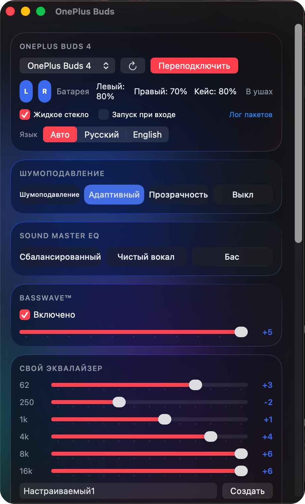
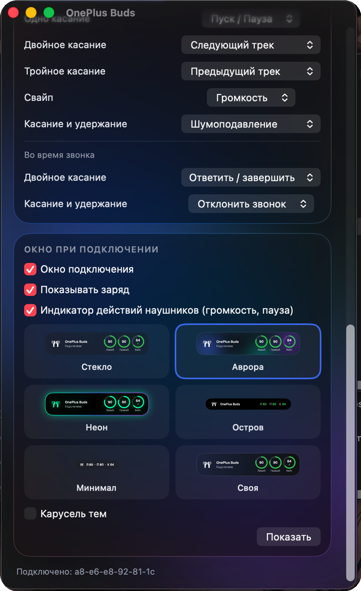
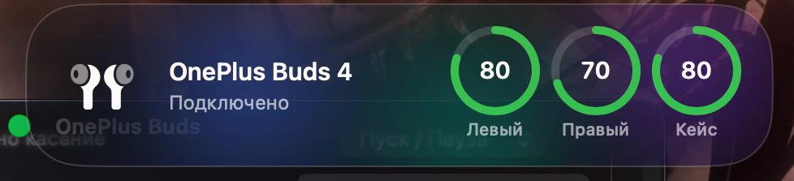

# OnePlus Buds for macOS

Нативное приложение для macOS (SwiftUI) для управления наушниками **OnePlus Buds 4 / Pro 3** — порт Windows-версии [Oneplus-buds-Win-Companion](https://github.com/Thomaspatrick14/Oneplus-buds-Win-Companion). Работает напрямую по Bluetooth RFCOMM, без телефона.

A native SwiftUI macOS companion for OnePlus Buds 4 / Pro 3 (port of the Windows companion). Talks to the earbuds directly over Bluetooth RFCOMM — no phone needed.

<p align="center">
  
  &nbsp;&nbsp;
  
</p>

<p align="center"></p>

## Возможности / Features

- **Шумоподавление**: ANC (уровни High / Moderate / Low / Auto), Адаптивный (Buds 4), Прозрачность, Выкл
- **Эквалайзер** Sound Master, **BassWave**, **свой эквалайзер** (6 полос, чтение и запись слотов с наушников)
- **Жесты**: настройка касаний, двойного/тройного касания, свайпа и удержания, жесты во время звонка
- **Заряд** левого / правого наушника и кейса, статус «в ушах»
- **Окно при подключении** появляется сразу при подключении наушников; темы: Стекло, Аврора, Неон, Остров, Минимал, Своя (картинка или видео с размытием), карусель тем (каждое подключение / день / неделя)
- **Индикаторы действий**: громкость, пауза/пуск, смена трека, режим шума — когда управляете наушниками касанием
- **Liquid Glass** на macOS 26 (на более старых — материал-фолбэк)
- Виджет рабочего стола (WidgetKit): малый / средний / большой, заряд, режим шума, кнопки режимов
- Иконка в меню-баре, автозапуск при входе, интерфейс на русском и английском
- Уведомления о подключении и отключении

## Требования / Requirements

- macOS 14 Sonoma или новее, Apple Silicon
- Xcode или Command Line Tools: `xcode-select --install`
- Наушники, сопряжённые в Системных настройках → Bluetooth

## Сборка / Build

```bash
./build.sh
```

Скрипт собирает `OnePlusBuds.app` (Swift Package + расширение виджета через `swiftc`), подписывает ad-hoc и копирует в `~/Applications`. Либо дважды щёлкните `build.command`.

Первый запуск: разрешите доступ к Bluetooth. Виджет: правый клик по рабочему столу → «Изменить виджеты» → OnePlus Buds. Если виджета нет в списке, перезайдите в учётную запись.

## Структура

| Путь | Что внутри |
|------|-----------|
| `Sources/OnePlusBuds/Protocol.swift` | кадры протокола, кодеки команд и ответов |
| `Sources/OnePlusBuds/AppModel.swift` | соединение RFCOMM, состояние, логика |
| `Sources/OnePlusBuds/Popups.swift` | окно подключения, HUD, темы |
| `Sources/OnePlusBuds/Activity.swift` | громкость / пауза / жесты |
| `Sources/OnePlusBuds/ContentView.swift`, `Theme.swift` | интерфейс |
| `Sources/OnePlusBuds/Strings.swift` | локализация (ru / en) |
| `Widget/` | расширение WidgetKit |

## Ограничения / Notes

- Проверено на OnePlus Buds 4 и Pro 3. Другие модели (OnePlus Buds Z/Pro/Pro 2/3, Nord Buds, OPPO Enco) определяются, но не проверялись.
- Кодек Bluetooth выбирает macOS (AAC / SBC), приложение его не меняет.
- Определение конкретного жеста по событию наушников приблизительное; сырые байты событий пишутся в `/Users/Shared/OnePlusBuds/gesture.log`.
- Неофициальный проект, не связан с OnePlus / OPPO.
